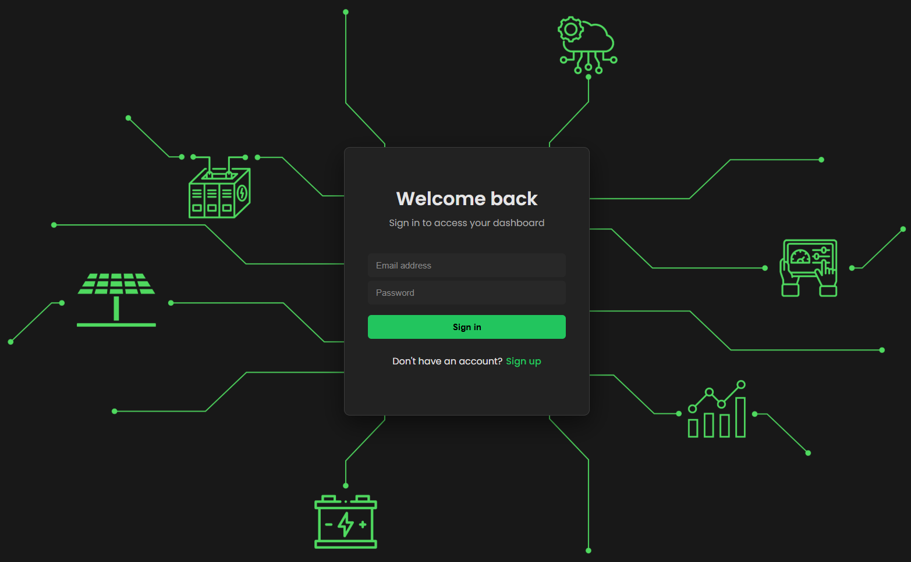
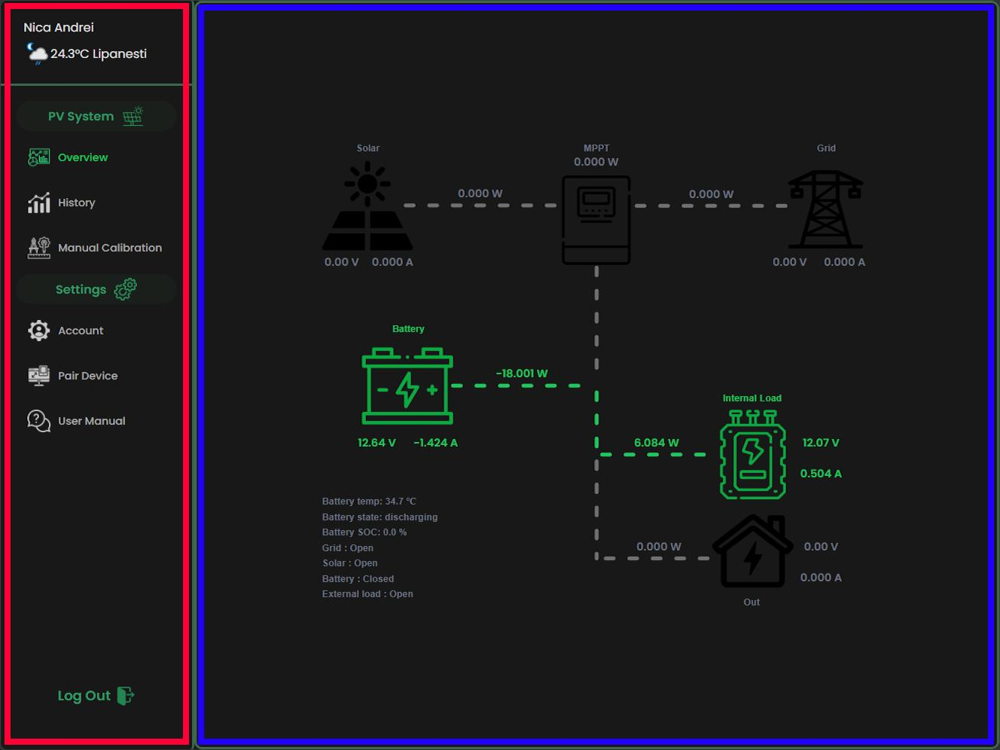
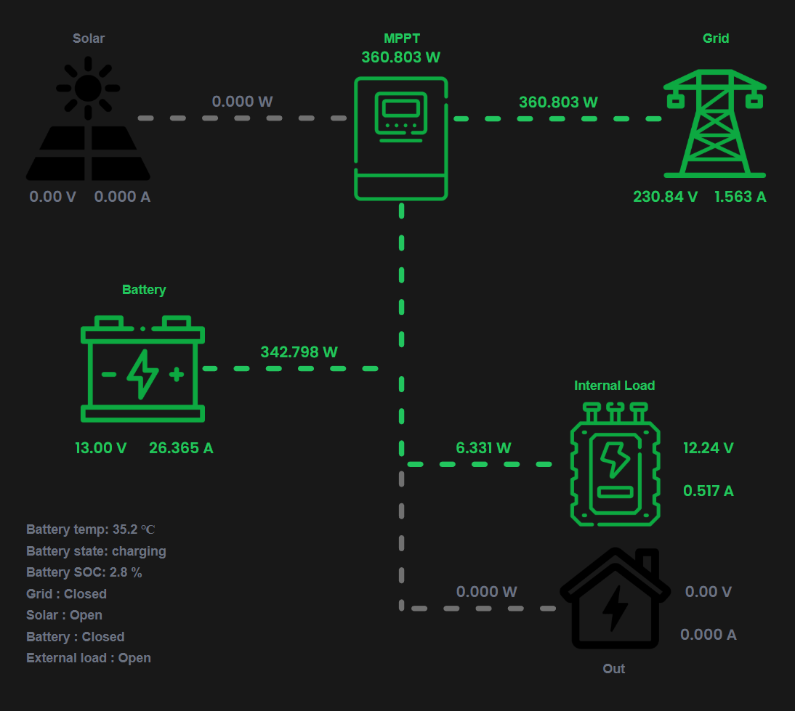
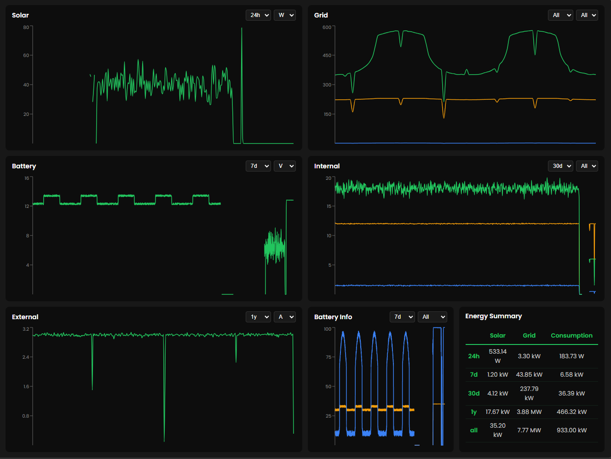
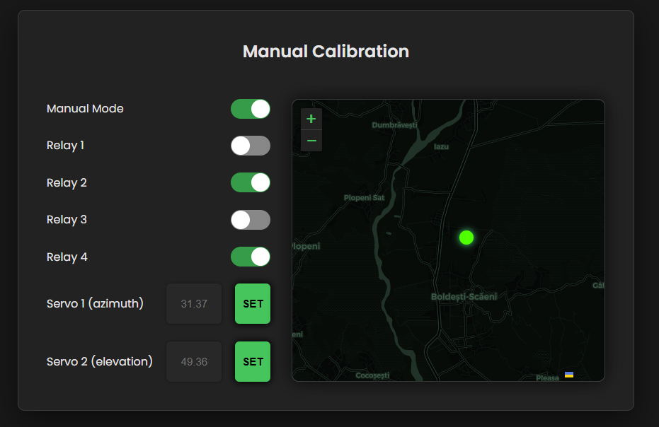
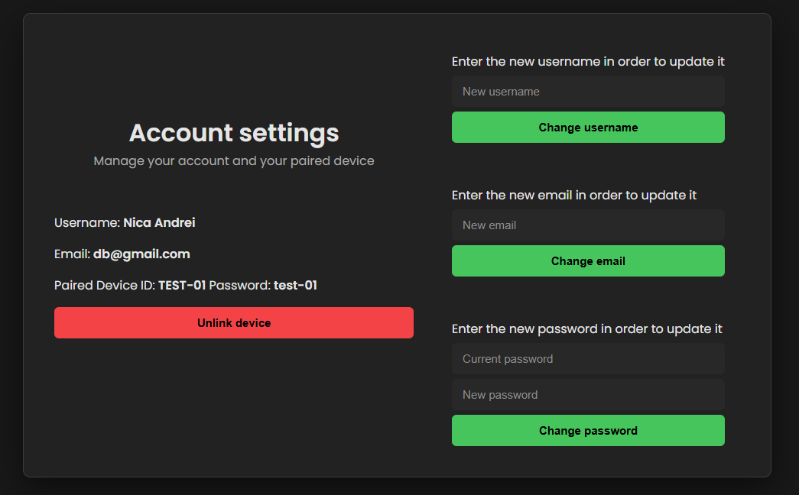
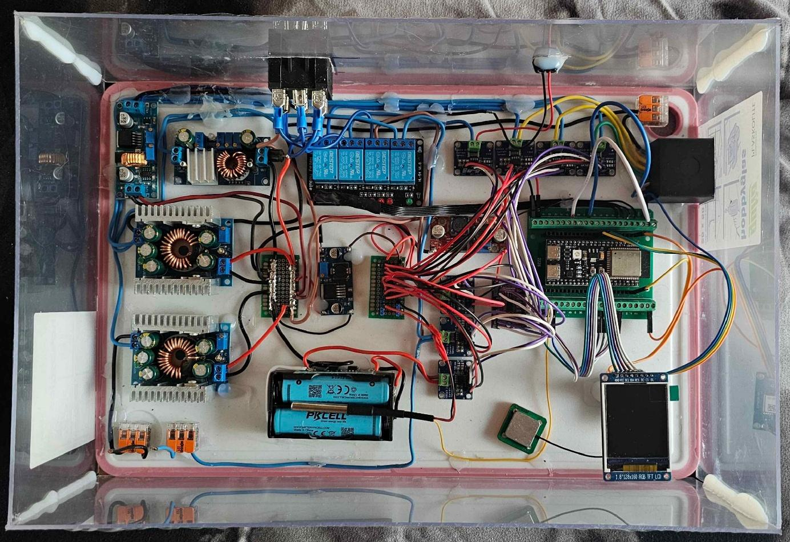
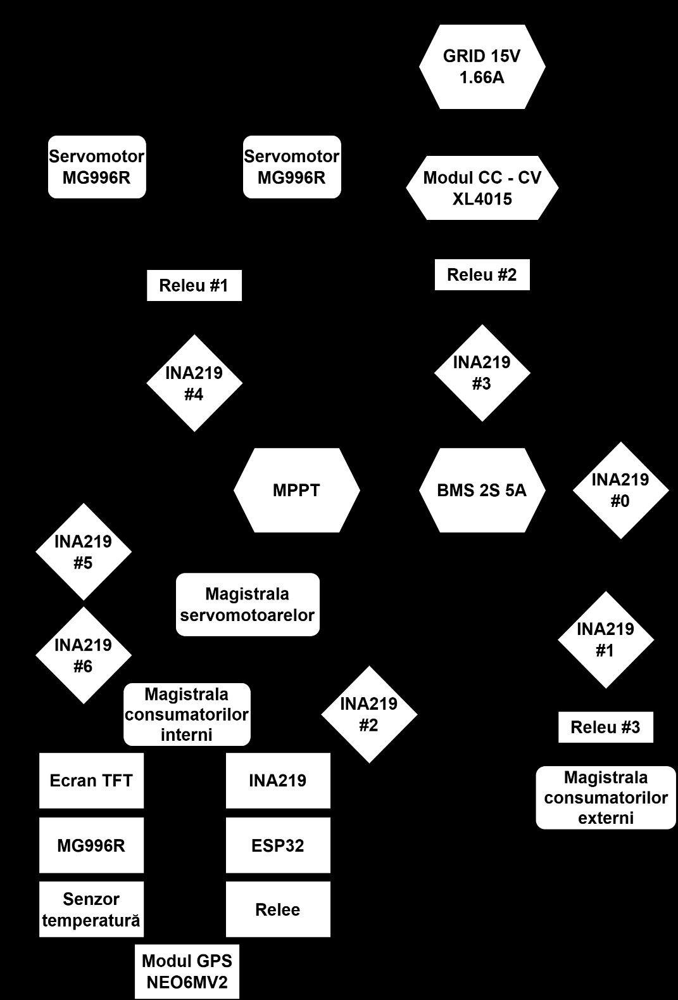

# Solar Monitor

> An IoT platform for real-time monitoring and remote control of solar energy systems — hardware-independent, built end to end with React and Node.js.


## Table of Contents

- [What is this?](#what-is-this)
- [Features](#features)
- [Architecture](#architecture)
- [Tech Stack](#tech-stack)
- [Project Structure](#project-structure)
- [How It Works](#how-it-works)
  - [Real-time data flow](#real-time-data-flow)
  - [Communication protocol](#communication-protocol)
  - [Authentication](#authentication)
  - [Data aggregation & retention](#data-aggregation--retention)
  - [Database schema](#database-schema)
- [Reference Hardware Platform](#reference-hardware-platform)
- [Prerequisites](#prerequisites)
- [Installation](#installation)
- [Running](#running)
- [Environment Variables](#environment-variables)
- [API Endpoints](#api-endpoints)
- [ESP32 Simulator](#esp32-simulator)
- [Testing](#testing)
- [Known Limitations](#known-limitations)
- [Future Work](#future-work)
- [Acknowledgements](#acknowledgements)

---

## What is this?

**Solar Monitor** is a web platform for monitoring and controlling photovoltaic (solar) energy systems in real time. It was developed as my bachelor's thesis project, but it is designed as a *generic*, hardware-independent solution: any IoT device that speaks the defined WebSocket + JSON protocol can plug into it and instantly get real-time monitoring, long-term historical storage and remote control — regardless of who manufactured the hardware.

The problem it solves: most commercial solar systems (e.g. Deye, Hy-Power/PowMr, Victron) lock the user into the manufacturer's own app, and smaller DIY systems built piece by piece usually have no remote platform at all. Solar Monitor provides one unified, self-hostable web dashboard that works with any compatible device.

## Screenshots

### Authentication

<p align="center">
  
</p>

### Dashboard — real-time energy flow

<p align="center">
  
</p>

<p align="center">
  
</p>

### History & charts

<p align="center">
  
</p>

### Manual calibration & GPS map

<p align="center">
  
</p>

### Account management

<p align="center">
  
</p>

### Architecture & hardware

<p align="center">
  
  
</p>

## Features

- **Real-time monitoring** — live voltage, current and power (V / A / W) for every part of the system, pushed over a single WebSocket connection once per second.
- **Interactive energy-flow diagram** — an animated SVG showing how energy moves between the solar panel, grid, MPPT, battery and loads.
- **Long-term history** — interactive line charts (Recharts) with selectable time ranges and metrics, including min/max/avg values.
- **Multi-level data aggregation** — an automatic pipeline that down-samples data from 5-minute resolution into hourly, daily and weekly tables, keeping storage tiny and charts fast.
- **Remote control** — toggle four relays (solar / grid / battery / external load) and set the two servo motor angles from the web UI.
- **Live GPS map** — the device's location is plotted on an interactive dark-themed Leaflet map.
- **Weather integration** — the GPS coordinates are also used to show current weather via WeatherAPI.
- **Device pairing** — devices register with the backend and are claimed by a user account via a generated secret.
- **Account management** — change username, email and password, or unpair a device.
- **Built-in user manual** — an FAQ page doubles as a digital user and developer manual.
- **Dark, green-accented UI** — consistent design focused on "green energy", styled with plain CSS (no UI framework).

## Architecture

The system has four components:

```
┌─────────────────┐        WebSocket (JSON, 1s)         ┌──────────────────┐
│   IoT Device    │ ──────────────────────────────────► │                  │
│  (ESP32-S3...)  │                                     │  Node.js backend │
└─────────────────┘                                     │  (Express + WS)  │
        ▲                                               │        │         │
        │ WebSocket (commands)                          │        │ REST    │
        └───────────────────────────────────────────────┤        ▼         │
                                                        │   PostgreSQL     │
                                                        └──────────────────┘
                                                                 ▲
                                                                 │ REST + WebSocket
                                                        ┌──────────────────┐
                                                        │  React frontend  │
                                                        └──────────────────┘
```

- **PostgreSQL** — relational storage for users, devices and sensor readings.
- **Node.js + Express backend** — REST API, WebSocket server, data aggregation and the static frontend host.
- **React frontend** — single-page application for login and the dashboard.
- **IoT devices** — any microcontroller that implements the communication protocol (an ESP32-S3 reference platform is provided as an example).

The data flow is split in two inside the backend: telemetry is (1) forwarded straight to the frontend for real-time display, and (2) handed to an **aggregator** that writes it to the database every 5 minutes. A separate **refactor** process later down-samples that data into hourly, daily and weekly tables. Commands travel the reverse path: frontend → backend → device, over the same WebSocket connection.

## Tech Stack

| Layer      | Technology                                                                 |
|------------|-----------------------------------------------------------------------------|
| Frontend   | React 19, Vite, React Router, Axios, Recharts, Leaflet, react-switch        |
| Backend    | Node.js, Express 5, WebSocket (`ws`), JWT, bcryptjs                         |
| Database   | PostgreSQL, Prisma 5                                                        |
| Auth       | JWT (users), HMAC-SHA256 (devices), bcrypt (passwords)                      |
| Deployment | Cloudflare Tunnel, static frontend served by Express (SPA catch-all)        |
| Tooling    | Vite, ESLint, nodemon, Prisma Migrate                                       |

## Project Structure

```
.
├── backend/                    # Node.js + Express API
│   ├── prisma/
│   │   ├── schema.prisma       # declarative database schema
│   │   └── migrations/         # generated SQL migrations
│   ├── src/
│   │   ├── middleware/         # authMiddleware (JWT), deviceMiddleware (HMAC)
│   │   ├── routes/             # authRoutes, dashboardRoutes, deviceRoutes
│   │   ├── services/           # websocket.js, aggregator.js, refactorReadings.js
│   │   ├── prismaClient.js     # shared Prisma client (loads .env)
│   │   └── server.js           # Express app + WebSocket bootstrap
│   └── tests/                  # data generators + ESP32 simulator
│
└── frontend/                   # React + Vite SPA
    ├── public/
    ├── src/
    │   ├── assets/             # images, SVG energy-flow diagram, animations
    │   ├── dashboard/          # DashboardLayout + pages + components
    │   │   ├── components/     # ChartCard, EnergySummary, BatteryMiniChart
    │   │   └── pages/          # Overview, History, ManualCalibration, Account, Faq, LinkDevice
    │   ├── login/              # AuthPage, LoginForm, SignUpForm
    │   └── services/           # websocket.jsx (real-time client)
    ├── config.js               # API/WS base URLs derived from env
    └── vite.config.js
```

## How It Works

### Real-time data flow

1. The device opens a WebSocket to `wss://<host>/esp` and authenticates with an HMAC signature.
2. Every **1 second** it sends a `telemetry` JSON message with all electrical parameters.
3. The backend (a) re-broadcasts it to any logged-in user whose device is paired, and (b) feeds it to the aggregator.
4. Every **5 minutes** the aggregator flushes the accumulated values into `SensorReading` as average/min/max per field.
5. Every **hour** the refactor process down-samples the 5-minute data into hourly → daily → weekly tables, filling gaps and deleting data past its retention window.

### Communication protocol

All real-time communication is JSON over WebSocket. Three message types exist.

**Device authentication** (sent once, on connect):

```json
{ "type": "auth", "deviceId": "ABCDE-12345", "hmac": "23jn2k34…" }
```

The `hmac` is `HMAC-SHA256(sharedSecret, deviceId)`.

**Telemetry** (device → server, every second):

```json
{
  "type": "telemetry",
  "data": {
    "solarV": 24.511, "solarA": 3.180, "solarW": 77.948,
    "gridV": 230.100, "gridA": 1.450, "gridW": 333.645,
    "battV": 12.800, "battA": 2.150, "battW": 27.520,
    "battTemp": 34.2, "battSoc": 73.5, "battState": "charging",
    "internalV": 12.100, "internalA": 0.480, "internalW": 5.808,
    "externalV": 12.050, "externalA": 1.020, "externalW": 12.291,
    "relay1": false, "relay2": false, "relay3": true, "relay4": true,
    "manual": false, "lat": 44.945, "long": 26.029,
    "servoAz": 90, "servoEl": 45
  }
}
```

**Command** (server → device):

```json
{
  "type": "command",
  "payload": {
    "manual": true,
    "relay1": false, "relay2": false, "relay3": true, "relay4": true,
    "servoAz": 120, "servoEl": 45
  }
}
```

**Web-client authentication** (frontend → server, on connect):

```json
{ "type": "auth", "token": "eyJhbGciOiJIUzI1NiIs..." }
```

### Authentication

- **Users** authenticate with email + password. Passwords are hashed with **bcrypt**; a **JWT** (valid for one day) is issued and sent on every REST request.
- **Devices** authenticate with **HMAC-SHA256** using a shared secret. A device registers once (returns a `claimSecret`), then a user pairs it to their account using that secret.

### Data aggregation & retention

The aggregator reduces database writes ~300× by buffering 1-second telemetry into 5-minute averages. The refactor process then maintains a multi-resolution pyramid:

| Table                  | Resolution | Retention |
|------------------------|------------|-----------|
| `SensorReading`        | 5 minutes  | 7 days    |
| `SensorReadingHourly`  | 1 hour     | 30 days   |
| `SensorReadingDaily`   | 1 day      | 1 year    |
| `SensorReadingWeekly`  | 1 week     | unlimited |

Gaps are filled with special `readingCount` markers (`-1` = backend offline, `0` = device offline) so the charts can distinguish "no data" from "zero value".

### Database schema

- **User** — `id`, `username`, `email` (unique), `password`, devices.
- **Device** — `deviceId` (unique), `claimSecret`, linked `userId`, readings.
- **SensorReading / Hourly / Daily / Weekly** — averaged (`V`, `A`, `W`), min and max values for solar, grid, battery, internal and external loads, plus battery temp/state/SOC, relay states and (on raw readings) GPS coordinates and servo angles.

## Reference Hardware Platform

To validate the architecture, a reference hardware platform was built around an **ESP32-S3**:

| Component               | Purpose                                                        |
|-------------------------|----------------------------------------------------------------|
| 7× INA219               | Voltage + current sensing (via a TCA9548A I²C multiplexer)     |
| NEO-6M GPS              | Latitude / longitude for the map and solar tracking            |
| LM35                    | Battery temperature                                            |
| 4-channel relay module  | Switches solar / grid / battery / external-load circuits (active-low, NC) |
| 2× MG996R servos        | Azimuth + elevation for solar tracking                         |
| TFT screen              | Local status display                                           |
| Access Point portal     | Initial WiFi configuration                                     |

Supporting passive components include an MPPT controller, a 2S2P battery with BMS, XL4015 CC-CV and LM2596 buck modules, and a 20W solar panel.

> The hardware is only a reference. Any microcontroller that implements the WebSocket + JSON protocol described above can be monitored and controlled by this platform.

## Prerequisites

- **Node.js 20+** (developed on Node 24)
- **PostgreSQL** running locally (or a connection string to one)
- A **WeatherAPI** key (optional — used for the weather widget)

## Installation

1. Clone the repository:

   ```bash
   git clone https://github.com/NicaEduardAndrei/Licenta-INFO.git
   cd Licenta-INFO
   ```

2. Install backend dependencies:

   ```bash
   cd backend
   npm install
   ```

3. Create your environment file:

   ```bash
   cp .env.example .env
   ```

   Fill in the values (see [Environment Variables](#environment-variables)).

4. Set up the database:

   ```bash
   npx prisma migrate dev
   ```

5. Install frontend dependencies:

   ```bash
   cd ../frontend
   npm install
   ```

6. Create the frontend environment file:

   ```bash
   cp .env.example .env
   ```

## Running

```bash
# Backend (http://localhost:3000)
cd backend
npm run dev

# Frontend (http://localhost:5173)
cd frontend
npm run dev
```

> In production, the backend serves the built frontend (`frontend/dist`) directly, so a single process hosts the whole app.

## Environment Variables

### Backend (`backend/.env`)

| Variable        | Description                                                   | Default         |
|-----------------|---------------------------------------------------------------|-----------------|
| `DATABASE_URL`  | PostgreSQL connection string                                  | —               |
| `JWT_SECRET`    | Secret for signing user JWT tokens                            | —               |
| `DEVICE_SECRET` | Shared secret for device HMAC-SHA256 authentication           | —               |
| `PORT`          | Backend port                                                  | `3000`          |
| `DOMAIN`        | Production domain (for CORS + HTTPS)                          | `localhost`     |
| `IP`            | Local network IP (for CORS in development)                    | —               |
| `NODE_ENV`      | `development` / `production`                                  | `development`   |
| `WS_URL`        | (Simulator only) WebSocket URL of the backend                 | `ws://localhost:3000/esp` |

### Frontend (`frontend/.env`)

| Variable          | Description                                          |
|-------------------|------------------------------------------------------|
| `VITE_IP`         | Backend IP used for API/WebSocket in development     |
| `VITE_WEATHER_API`| WeatherAPI key (optional)                            |

## API Endpoints

### Auth — `/api/auth`

| Method | Endpoint      | Request Body                              | Response |
|--------|---------------|-------------------------------------------|----------|
| POST   | `/register`   | `{ username, email, password }`           | `{ token }` |
| POST   | `/login`      | `{ email, password }`                     | `{ token }` |

### Dashboard — `/api/dashboard` (JWT required)

| Method | Endpoint                  | Request Body / Query                        | Response |
|--------|---------------------------|---------------------------------------------|----------|
| GET    | `/`                       | —                                           | `{ user }` (incl. paired devices) |
| POST   | `/pair-device`            | `{ deviceId, claimSecret }`                 | `{ message }` |
| GET    | `/charts/:category`       | `?range=24h\|7d\|30d\|1y\|all`              | `{ data }` |
| GET    | `/energy-summary`         | `?range=24h\|7d\|30d\|1y\|all`              | `{ solarW, gridW, consumedW }` |
| PUT    | `/username`               | `{ username }`                              | `{ message }` |
| PUT    | `/email`                  | `{ email }`                                 | `{ message }` |
| PUT    | `/password`               | `{ currentPassword, newPassword }`          | `{ message }` |
| DELETE | `/delete-paired-device`   | —                                           | `{ message }` |

> Chart categories: `solar`, `grid`, `battery`, `internal`, `external`. Each returns timestamped `V`, `A`, `W` plus min/max fields.

### Device — `/api/device` (HMAC required)

| Method | Endpoint      | Request Body                              | Response |
|--------|---------------|-------------------------------------------|----------|
| POST   | `/register`   | `{ deviceId, hmac }`                      | `{ claimSecret, device }` |

> All error responses return `{ message: string }`.

## ESP32 Simulator

A WebSocket-based simulator is included so you can test the platform without physical hardware:

```bash
cd backend/tests
node simulateESP32.js
```

It authenticates with HMAC (using `DEVICE_SECRET` from `backend/.env`), then streams realistic telemetry and responds to commands. Set `WS_URL` in `backend/.env` to point it at a different backend.

## Testing

Several scripts in `backend/tests/` generate and clean test data:

| Script                  | Purpose                                                            |
|-------------------------|--------------------------------------------------------------------|
| `generateTestData.js`   | Creates 10 test devices and 5-minute raw readings                  |
| `generatePeakTestData.js`| Generates a large peak-load dataset (10k devices)                 |
| `seedReadings.js`       | Seeds 2 years of realistic data with simulated offline gaps        |
| `deleteTestData.js`     | Removes all `TEST-*` devices and readings                          |

Frontend checks:

```bash
cd frontend
npm run lint
npm run build
```

## Known Limitations

- Automatic solar tracking currently runs on the microcontroller, not from the web UI (manual servo control is available).
- The UI displays a single paired device (multi-device selection is a planned feature).
- No notification/alert system yet.
- The interface is desktop-first (usable but not optimized on mobile).
- Both device and user require an active internet connection for real-time operation.

## Future Work

- Automatic solar tracking driven from the web dashboard.
- Multi-device support with a device selector.
- Mobile-optimized (or native mobile) interface.
- Notification system for battery/connectivity events.

## Acknowledgements

- Energy-flow diagram designed in **Figma**, icons from **Flaticon**, loading animation created in **Adobe After Effects**.
- Built with open-source technologies only — zero operating cost.

---

> **Note:** This README was drafted with the help of an AI assistant and reviewed/edited by the author.
